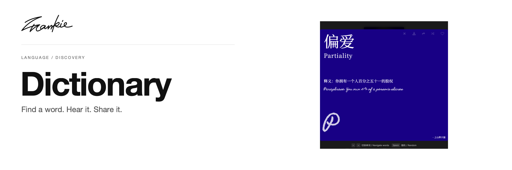

# Blue Dictionary

[English](README.md) · [简体中文](README.zh-CN.md)

Find a Chinese word, open its explanation, and listen or share it.

[Introduction](https://songhaifan.github.io/frankie-dictionary/) · [Guide](docs/guide.md) · [Run locally](#run-locally)

## What it does

- Search the bundled word collection with fuzzy matching.
- Browse neighboring entries or discover a random word.
- Play available audio and share an individual word view.

## Run locally

```sh
npm ci
npm run dev
```

Open the address printed by Next.js, normally http://localhost:3000.

## Before you start

The word collection is bundled with the app. Audio is available for entries that provide it; explanations and playback controls live in the word-card view.

## For developers

```sh
npm run lint
npm run build
npm start
```

[Project guide](docs/guide.md) · [Artwork](docs/readme/README.md)

---

Made by [Songhai Fan](https://github.com/SonghaiFan) · A Frankie project
