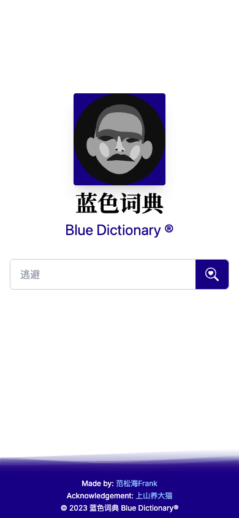

<h1 align="center"><picture><source media="(prefers-color-scheme: dark)" srcset=".github/brand/icon-dark.svg"></picture><br>Blue Dictionary</h1>

<p align="center"><b>查找中文词语，打开释义，再聆听或分享。</b></p>

<p align="center"><a href="https://songhaifan.github.io/frankie-dictionary/zh/">项目介绍</a> · <a href="https://blue-dictionary.vercel.app">打开应用</a> · <a href="docs/guide.md">使用指南</a> · <a href="README.md">English</a></p>

<p align="center"></p>

## 可以做什么

- 使用模糊匹配搜索内置词库。
- 浏览相邻词条，或随机发现一个词语。
- 播放可用的音频，并分享单独的词条页面。

## 本地运行

```sh
npm ci
npm run dev
```

打开 Next.js 输出的地址，通常为 http://localhost:3000。

## 开始之前

词库随应用一起提供。部分词条带有音频；释义与播放控件都在词条卡片中。

## 开发说明

```sh
npm run lint
npm run build
npm start
```

[项目指南](docs/guide.md) · [Banner 维护](docs/readme/README.md)

---

<!-- series-footer:start -->

<p align="center">
<a href="https://songhaifan.github.io/frankie-brain/"></a> &nbsp; <a href="https://songhaifan.github.io/frankie-cards/"></a> &nbsp; <a href="https://songhaifan.github.io/frankie-dictionary/"></a> &nbsp; <a href="https://songhaifan.github.io/frankie-generative-art/"><picture data-monochrome="frankie-generative-art"><source media="(prefers-color-scheme: dark)" srcset="https://raw.githubusercontent.com/SonghaiFan/SonghaiFan/main/assets/series/frankie-generative-art-dark.svg"></picture></a> &nbsp; <a href="https://songhaifan.github.io/frankie-goal/"><picture data-monochrome="frankie-goal"><source media="(prefers-color-scheme: dark)" srcset="https://raw.githubusercontent.com/SonghaiFan/SonghaiFan/main/assets/series/frankie-goal-dark.svg"></picture></a> &nbsp; <a href="https://songhaifan.github.io/frankie-guitar/"></a> &nbsp; <a href="https://songhaifan.github.io/frankie-list/"></a> &nbsp; <a href="https://songhaifan.github.io/frankie-mbti/"></a> &nbsp; <a href="https://songhaifan.github.io/frankie-onitama/"></a> &nbsp; <a href="https://songhaifan.github.io/frankie-owspace-api/"></a> &nbsp; <a href="https://songhaifan.github.io/frankie-poker/"></a> &nbsp; <a href="https://songhaifan.github.io/frankie-stocks/"></a> &nbsp; <a href="https://songhaifan.github.io/frankie-tarot/"></a> &nbsp; <a href="https://songhaifan.github.io/frankie-tarot-api/"></a> &nbsp; <a href="https://songhaifan.github.io/frankie-werewolf/"></a>
</p>

<p align="center"><sub>Frankie series · Made by <a href="https://github.com/SonghaiFan">Songhai Fan</a></sub></p>

<!-- series-footer:end -->

<p align="right"><picture><source media="(prefers-color-scheme: dark)" srcset=".github/brand/signature-dark.svg"></picture></p>
