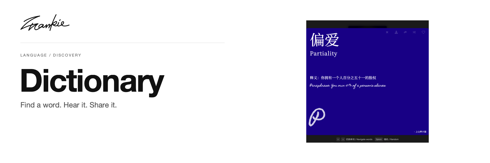

# Blue Dictionary

[English](README.md) · [简体中文](README.zh-CN.md)

查找中文词语，打开释义，再聆听或分享。

[介绍页](https://songhaifan.github.io/frankie-dictionary/zh/) · [项目指南](docs/guide.md) · [本地运行](#本地运行)

## 可以做什么

- 使用模糊匹配搜索内置词库。
- 浏览相邻词条，或随机发现一个词语。
- 播放可用的音频，并分享单独的词条页面。

## 本地运行

```sh
npm ci
npm run dev
```

打开 Next.js 输出的地址，通常为 http://localhost:3000。

## 开始之前

词库随应用一起提供。部分词条带有音频；释义与播放控件都在词条卡片中。

## 开发说明

```sh
npm run lint
npm run build
npm start
```

[项目指南](docs/guide.md) · [Banner 维护](docs/readme/README.md)

---

由 [Songhai Fan](https://github.com/SonghaiFan) 制作 · Frankie 系列项目
